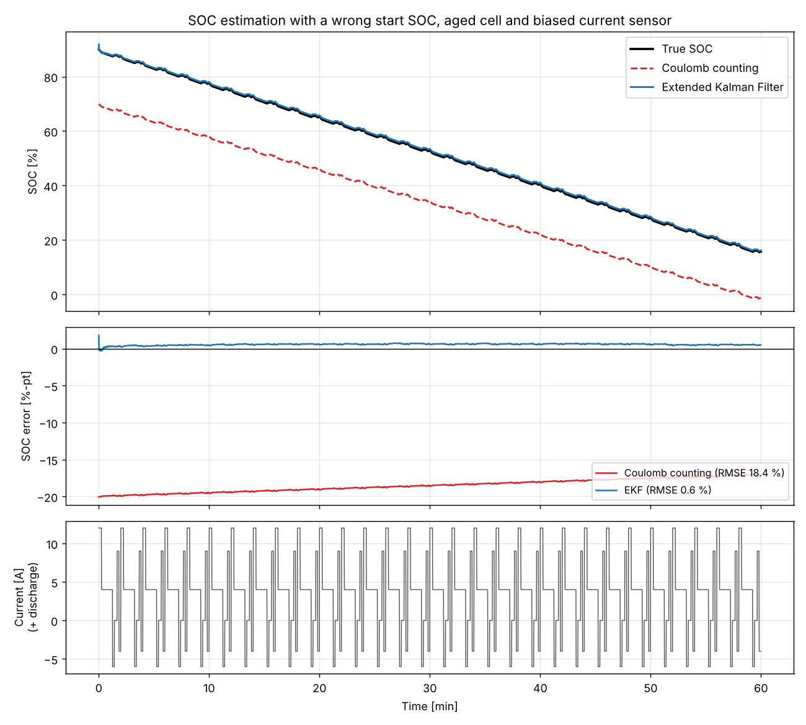

# SOC Estimation: Coulomb Counting vs Extended Kalman Filter

A compact Python study of battery **state-of-charge (SOC) estimation** under the error sources a real BMS has to live with: an unknown starting SOC, an aged cell and a biased current sensor.

It compares open-loop **Coulomb counting** with a model-based **Extended Kalman Filter (EKF)** on a first-order equivalent-circuit cell model.



## Result

| Estimator | RMSE | Max error | Final error |
|---|---|---|---|
| Coulomb counting | 18.4 %-pt | 19.8 %-pt | −17.0 %-pt |
| Extended Kalman Filter | **0.6 %-pt** | **0.8 %-pt** | **+0.5 %-pt** |

*Errors in SOC percentage points over a 60-minute drive cycle, excluding the first 5 minutes.*

Coulomb counting never recovers from the wrong starting SOC and reports the cell as empty (below 0 %) at the end of the drive while it still holds about 16 %. The EKF uses the measured terminal voltage to pull the estimate onto the true SOC within seconds, then tracks it to within 1 %-pt.

## Scenario

| Error source | True value | What the BMS assumes |
|---|---|---|
| Starting SOC | 90 % | 70 % (e.g. after a long rest with no reliable OCV reading) |
| Cell capacity | 4.6 Ah (~92 % SOH) | 5.0 Ah (nameplate) |
| Current sensor | true current | +0.15 A offset, 0.05 A noise |
| Voltage sensor | true voltage | 5 mV noise |

The drive cycle is a repeated 2-minute urban pattern: acceleration, cruise, regenerative braking and idle, averaging about 0.75 C.

## Model

First-order (1RC) equivalent circuit, positive current = discharge:

```
SOC[k+1] = SOC[k] − I·Δt / (3600·Q)
Vrc[k+1] = a·Vrc[k] + R1·(1 − a)·I,      a = exp(−Δt / R1·C1)
Vt[k]    = OCV(SOC) − R0·I − Vrc
```

The OCV curve uses the combined model `K0 + K1·s + K2·ln(s) + K3·ln(1−s)`, tuned to a plausible NMC-like shape (≈3.4 V empty, ≈4.2 V full).

The EKF state is `x = [SOC, Vrc]`. The measurement Jacobian uses the OCV slope `dOCV/dSOC`, which is where the voltage feedback gets its leverage on SOC.

## What this shows

- **Coulomb counting is only as good as its inputs.** Any error in initial SOC, capacity or current offset stays in the estimate or accumulates over time.
- **An EKF gives closed-loop correction**, but only to the extent the OCV curve has slope. On flat-OCV chemistries such as LFP, the same filter has much less to work with.
- **Residual bias remains.** The +0.5 %-pt steady error comes from the capacity and current-offset mismatch, which the filter does not estimate.

## Possible next steps

- Augment the state with capacity and current offset (dual or joint estimation) to remove the residual bias.
- Add temperature-dependent parameters and an LFP OCV curve to test the flat-OCV case.
- Validate on a public cell dataset (e.g. CALCE or NASA) instead of synthetic data.
- Compare with an Unscented Kalman Filter.

## Running it

```bash
pip install -r requirements.txt
python run_demo.py      # prints the error table and saves docs/results.png
pytest                  # 4 tests: OCV sanity, EKF convergence, CC drift, CC ideal case
```

## Repository layout

```
soc_estimation/
  battery_model.py   1RC cell model and OCV curve
  estimators.py      Coulomb counter and EKF
  simulation.py      drive cycle, sensor errors, scenario runner
run_demo.py          runs the scenario and makes the plot
tests/               pytest checks
docs/results.png     output figure
```

## About

Built by **Ali Turan**, an Electrical engineer with 15+ years in BMS and EV/hybrid powertrain development, including SOC algorithm development for BMS application software. Developed with AI-assisted coding (Claude Code).

[LinkedIn](https://www.linkedin.com/in/ali-turan-392b66b/)

All data in this repository is synthetic. No proprietary or employer information is used.
